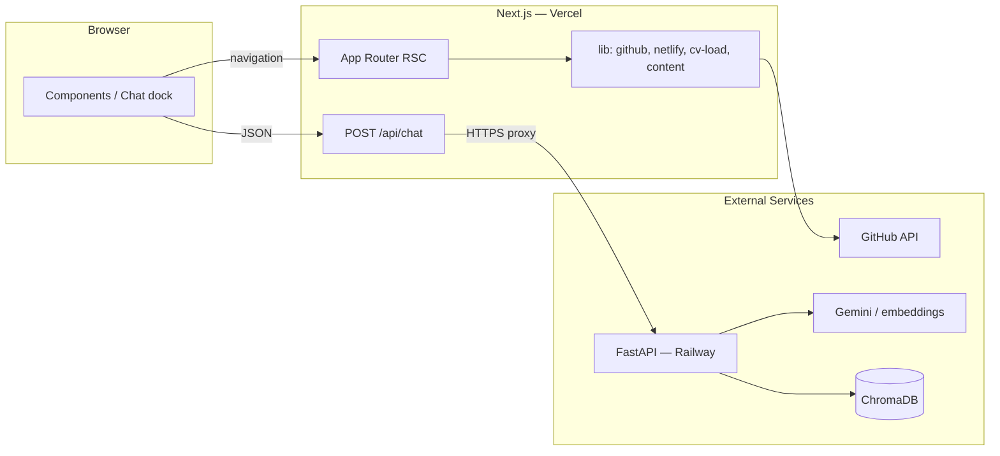

# NBW — Portfolio

Personal portfolio monorepo: marketing site with GitHub-backed project list, printable CV, optional Netlify enrichment, and a RAG on-site assistant.

**[Otvori sajt](https://my-portfolio-newbluewoods-projects.vercel.app/)** · CV: [`/cv`](https://my-portfolio-newbluewoods-projects.vercel.app/cv)

[](https://nextjs.org/)
[](https://react.dev/)
[](https://tailwindcss.com/)
[](https://fastapi.tiangolo.com/)
[](https://www.llamaindex.ai/)
[](https://ai.google.dev/)
[](https://vercel.com/)
[](https://railway.app/)

> **AI / agent context (stack, layout, deploy pitfalls):** see **[`CLAUDE.md`](CLAUDE.md)** and [`AGENTS.md`](AGENTS.md).

---

## What This Site Does

| Feature | Description |
|---------|-------------|
| **Home** | About me — content from `content/*.md`, mobile-first layout |
| **Projects** | Live GitHub repo list + manual projects, grouped by category, Netlify deploy hints |
| **CV** | Printable résumé at `/cv`, content in `content/cv.json`, A4-optimized print layout |
| **Lab** | Deploy links and live demos for projects |
| **Diplomas & Certificates** | Scanned credentials section on the home page |
| **RAG Assistant** | On-site chat — retrieval-augmented generation over curated Markdown + README snapshots |

---

## Architecture

The site is a **monorepo with two independent services**: a Next.js frontend (Vercel) and a FastAPI backend (Railway / Docker).



**Chat flow:** Browser → `POST /api/chat` (Next BFF) → FastAPI `/chat` → Gemini + Chroma (RAG). No API key is ever exposed to the client.

---

## Tech Stack

| Layer | Stack | Notes |
|-------|-------|-------|
| Frontend | Next.js 15, React 19, Tailwind CSS v4 | App Router, server components by default |
| Backend | FastAPI, LlamaIndex, ChromaDB | RAG assistant with Gemini embeddings |
| LLM | Google Gemini | Via `GOOGLE_API_KEY` server-side only |
| Content | `content/*.md` + `content/cv.json` | Synced to `web/_content/` at build time |
| Hosting | Vercel (frontend) + Railway (API) | Persistent Chroma volume on Railway |
| Validation | Zod | Client/server env split |

---

## Repository Layout

```
Portfolio App/
├── web/                    # Next.js — Vercel Root Directory = web
│   ├── src/app/            # App Router pages + api/chat proxy
│   ├── src/components/     # Header, chat dock, CV, lab scenes
│   ├── src/lib/            # github, env, cv-load, RAG proxy
│   └── scripts/            # sync-content.mjs
├── api/
│   ├── portfolio_api/      # main.py, rag.py, ingest.py, settings.py
│   └── Dockerfile          # Built from monorepo root context
├── content/                # about.md, skills.md, cv.json, …
├── .env.example            # Template (never commit real .env)
├── DEPLOY.md               # Vercel + Railway checklist
├── LLAMAINDEX_GUIDE.md     # RAG / LlamaIndex notes
└── CLAUDE.md               # Full AI dev context
```

---

## Quick Start

**Prerequisites:** Node 20+, Python 3.11+, [Google AI Studio](https://aistudio.google.com/) API key.

### 1. Environment

```bash
cp .env.example .env
# Fill in: GOOGLE_API_KEY, GITHUB_USERNAME, NEXT_PUBLIC_DISPLAY_NAME
```

### 2. Index Knowledge (RAG)

```bash
cd api
..\venv\Scripts\pip install -e .        # Windows
..\venv\Scripts\portfolio-ingest
```

On Unix: `source ../venv/bin/activate` then `portfolio-ingest`.

### 3. Run the API

```bash
# From root:
npm run dev:api                          # Port 8020
```

### 4. Run the Site

```bash
cd web
npm install
npm run dev                              # http://localhost:3000
```

### 5. Diagnostics

```bash
npm run doctor                           # Check env, content, API health
npm run doctor -- --fix                  # Auto-sync content
npm run doctor -- --strict               # Exit 1 on warnings (CI)
```

---

## Workflows

| Command | What it does |
|---------|--------------|
| `npm run workflow:minimal` | Kill ports → doctor `--fix` → dev (gentle restart) |
| `npm run dev:full` | Clean → doctor → API + Next parallel + background health check |
| `npm run kill:dev` | Free ports 3000, 8000, 8001, 8020 (Windows) |
| `npm run clean:web` | Delete `.next` + `node_modules/.cache` |

---

## Deploy

| Service | Platform | Notes |
|---------|----------|-------|
| **Frontend** | Vercel | Root Directory = `web`, Node 20, include files outside root |
| **API** | Railway | Docker (`api/Dockerfile`), persistent volume at `/data/chroma` |

Full checklist: **[`DEPLOY.md`](DEPLOY.md)**.

**Key env vars on Vercel:** `PORTFOLIO_API_URL` (Production **and** Preview), `GITHUB_USERNAME`, `GITHUB_TOKEN`.  
**Key env vars on Railway:** `GOOGLE_API_KEY`, `GITHUB_USERNAME`, `CORS_ORIGINS`.

---

## Security

- Secrets only in `.env` (gitignored) — never inline keys in code
- Chat goes through BFF (`/api/chat`), not directly from browser to API
- `NEXT_PUBLIC_*` only for truly public values

---

## Docs

| Document | Purpose |
|----------|---------|
| [`CLAUDE.md`](CLAUDE.md) | Full AI dev context, architecture, rules |
| [`DEPLOY.md`](DEPLOY.md) | Vercel + Railway deploy checklist |
| [`LLAMAINDEX_GUIDE.md`](LLAMAINDEX_GUIDE.md) | RAG / LlamaIndex behavior guide |
| [`.env.example`](.env.example) | Variable names and hints |

---

## License

Private project. Not open for public forking without agreement.
